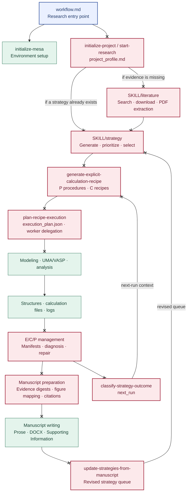
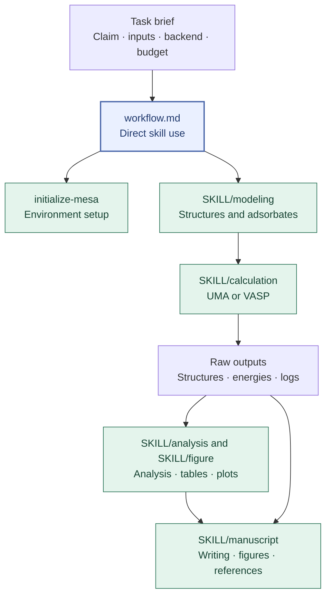

# MESA Ablation

This comparison covers the change from `f89b828` to `c4596ba`. Arrows
represent calls and artifact handoffs documented by `workflow.md` and the
domain skills. Red blocks are removed, × ends a cut connection, blue blocks
are rewritten entry points, and green blocks are retained capabilities.

## Repository tree

$\color{red}\textsf{(d) = deleted}$ · $\color{blue}\textsf{(m) = modified}$

Fully deleted folders are shown once. A folder marked (m) groups its modified
files. Unmarked leaves show unchanged paths for context.

`.`\
`├──` $`\color{red}\texttt{(d) .codex/}`$\
`├──` $`\color{blue}\texttt{(m) .gitignore, AGENTS.md, README.md, workflow.md}`$\
`├──` `DEPENDENCY/`\
`│   ├──` $`\color{blue}\texttt{(m) .env.example, README.md, runtimes.yaml}`$\
`│   ├──` $`\color{blue}\texttt{(m) tools/mesa\_env\_support/}`$\
`│   └──` `bootstrap.sh, bootstrap.ps1, sync_codex_skills.sh`\
`├──` `ENVIRONMENT/`\
`│   ├──` $`\color{red}\texttt{(d) paper\_search/}`$\
`│   └──` `build_tools/, fairchem/, vasp-submit-linker/, manuscript_tools/`\
`├──` $`\color{red}\texttt{(d) EXTERNAL/paper-search-mcp/}`$\
`└──` `SKILL/`\
`    ├──` $`\color{red}\texttt{(d) literature/, strategy/, orchestration/}`$\
`    ├──` `init/`\
`    │   ├──` $`\color{red}\texttt{(d) initialize-project/, start-research/}`$\
`    │   └──` $`\color{blue}\texttt{(m) initialize-mesa/SKILL.md}`$\
`    ├──` `modeling/`\
`    │   ├──` $`\color{red}\texttt{(d) propose-surface-models-from-literature/}`$\
`    │   ├──` $`\color{blue}\texttt{(m) workflow.md, import-bulk-structure/}`$\
`    │   ├──` $`\color{blue}\texttt{(m) build-slab-models/, build-gas-phase-models/}`$\
`    │   └──` `place-adsorbates-with-adsorbdiff/, place-adsorbates-with-mjs/`\
`    ├──` `calculation/`\
`    │   ├──` $`\color{blue}\texttt{(m) workflow.md}`$\
`    │   ├──` `relax-uma-trajectory/, calculate-uma-vibrational-frequencies/`\
`    │   ├──` `manage-vasp-jobs/, vasp-lab-job/`\
`    │   └──` `analyze-relaxation-results/, balance-reaction-pathway/`\
`    ├──` `analysis/`\
`    │   ├──` $`\color{blue}\texttt{(m) workflow.md, construct-energy-diagram/}`$\
`    │   ├──` `evaluate-energy-diagram/, correct-dft-energy/`\
`    │   └──` `analyze-dband-center/, charge-flow-analyzer/, assemble-alkaline-her-descriptors/`\
`    ├──` `figure/`\
`    │   ├──` $`\color{blue}\texttt{(m) workflow.md}`$\
`    │   ├──` `plot-energy-diagram/, plot-dos/, plot-sabatier-volcano/`\
`    │   └──` `render-adsorbate-structure-grid/, create-nature-figure/`\
`    └──` `manuscript/`\
`        ├──` $`\color{blue}\texttt{(m) workflow.md, akct/, si/, polish/}`$\
`        ├──` $`\color{red}\texttt{(d) figure/, tests/, shared/method\_citations.py}`$\
`        ├──` `review/, shared/numeric_precision.py`\
`        ├──` `general/`\
`        │   ├──` $`\color{red}\texttt{(d) extract-citation-sources/, select-citations/, insert-citations/}`$\
`        │   └──` $`\color{blue}\texttt{(m) insert-section-into-docx/SKILL.md}`$\
`        ├──` `intro/`\
`        │   ├──` $`\color{red}\texttt{(d) collect-introduction-evidence/}`$\
`        │   └──` `write-introduction-section/`\
`        │       ├──` $`\color{red}\texttt{(d) references/, scripts/}`$\
`        │       └──` $`\color{blue}\texttt{(m) SKILL.md, agents/openai.yaml}`$\
`        ├──` `methods/`\
`        │   ├──` $`\color{red}\texttt{(d) collect-methods-evidence/}`$\
`        │   └──` `write-methods-sections/`\
`        │       ├──` $`\color{red}\texttt{(d) references/output\_schema.md, scripts/}`$\
`        │       ├──` $`\color{blue}\texttt{(m) SKILL.md, agents/openai.yaml}`$\
`        │       └──` `references/methods_formalism_guide.md`\
`        └──` `results/`\
`            ├──` $`\color{red}\texttt{(d) collect-results-evidence/}`$\
`            └──` `write-results-section/`\
`                ├──` $`\color{red}\texttt{(d) references/, scripts/}`$\
`                └──` $`\color{blue}\texttt{(m) SKILL.md, agents/openai.yaml}`$

## Original workflow with the cuts marked

## Direct tool use in ablation

This is a representative data path. The task supplies the inputs, backend,
and execution limits. The selected skills depend on what the task calls for.

## What was removed

| Block | Removed code and interfaces |
| --- | --- |
| Project startup | `initialize-project`, `start-research`, and discovery or creation of `project_profile.md`. |
| Literature | `SKILL/literature/`, the paper-search MCP and runtimes, and `propose-surface-models-from-literature`. |
| Strategy and feedback | `SKILL/strategy/`, including candidate generation, selection, outcome classification, and manuscript-driven updates. Both `next_run` and the revised strategy queue disappear. |
| Scientific execution management | `SKILL/orchestration/`, including recipe generation, execution plans, worker delegation, and E/C/P management of attempts, calculations, and procedures. |
| Manuscript preparation | The MESA-specific evidence collectors and writer digests, strategy figure pipeline, and automated citation extraction, selection, and insertion. General writing and DOCX tools remain available. |

The original relationships are documented in the [original workflow](https://github.com/GuGroup/mesa/blob/f89b82852e94d6feb33501ab360955e174173874/workflow.md)
and [orchestration guide](https://github.com/GuGroup/mesa/blob/f89b82852e94d6feb33501ab360955e174173874/SKILL/orchestration/workflow.md).
See the current [workflow](workflow.md) and [manuscript guide](SKILL/manuscript/workflow.md)
for the remaining entry points. The [commit diff](https://github.com/kangmg/mesa/compare/f89b82852e94d6feb33501ab360955e174173874...c4596ba5870794cd874125dba9213d08ffff22dd)
shows the source changes behind the diagram.
