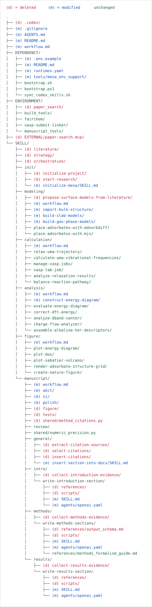
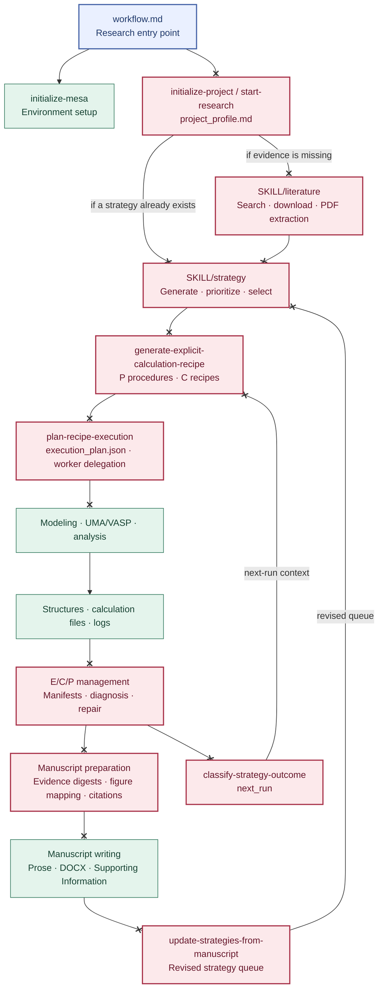
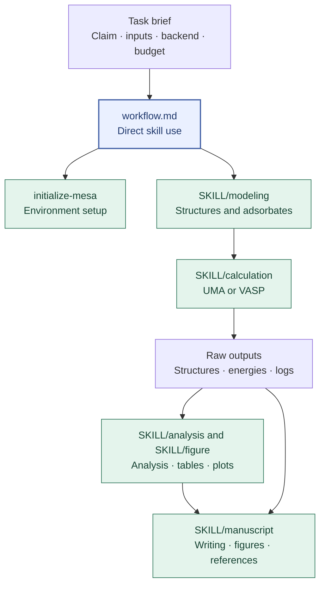

# MESA Ablation

To assess the loss of research capability, we removed MESA's research knowledge
layer. This layer covered literature search and interpretation, hypothesis
formulation, strategy generation, procedures for executing strategies and
recording results in a structured form, and evidence-grounded manuscript writing.
We also revised `workflow.md` and related skill guides to remove instructions
for the ablated steps.

## Repository tree

## Original workflow with the cuts marked

## Direct tool use in ablation

